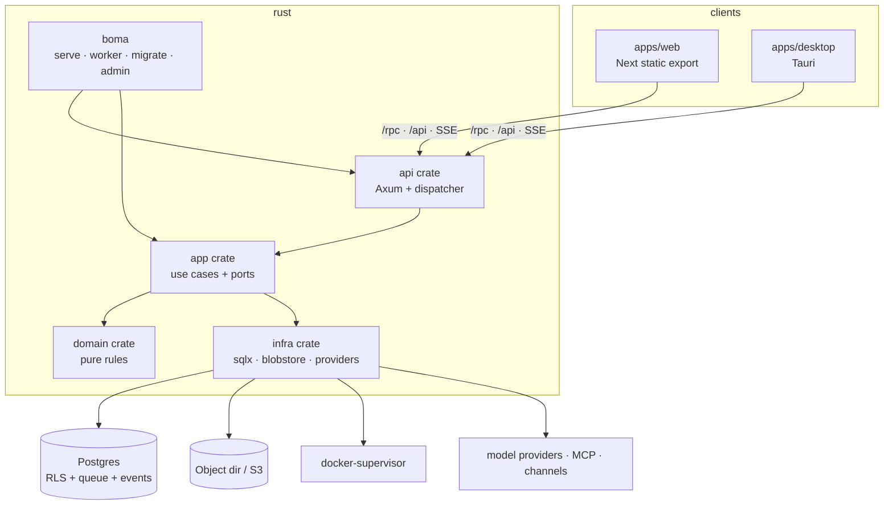

# Rebuild plan — Boma Bot

Source of truth: `spec/` (exported 2026-11-12T02:54Z from the analysis workspace, 48 files).
Evidence for every requirement: `spec/TRACE.md`. Defects to fix: `spec/05-known-defects.md`.
Decisions still open with the owner: `spec/06-decisions-needed.md`, mirrored in `docs/STATE.md`.

Claims below are **CONFIRMED** (read in `spec/`, or produced by a command run in this workspace) or
**GUESS** (inferred). This plan ran no build and no test: nothing here is verified by execution yet.

---

## 1. What we are rebuilding

Boma Bot is a self-hosted platform for persistent AI teammates ("bots"). Each bot keeps one
conversation, remembers across sessions, runs on cron schedules, calls integrations and MCP tools,
and can drive a sandboxed computer (browser, shell, desktop). A Rust backend exposes a procedure-style
JSON API and a small HTTP surface; a web app, a desktop shell and (later) a mobile shell are the
clients. Everything is multi-tenant by space, with approval-gated side effects and an idempotent
external-effect ledger. **CONFIRMED** in `spec/00-overview.md`, `spec/03-api-contract.md`.

| Metric | Value | Source |
|---|---|---|
| Requirements | **58** total: **39 MUST**, **17 SHOULD**, **2 COULD** | `grep -cE` over `spec/01-requirements.md` |
| API goldens | **30** | `spec/EXPORT.md` |
| UI goldens | **7** | `spec/EXPORT.md` |
| Known defects to fix | **9** (D-01 … D-09) | `spec/05-known-defects.md` |
| Open decisions | 13 (DEC-01 … DEC-13) | `spec/06-decisions-needed.md` |
| Locales in the reference | 15 (2 RTL) | `spec/04-nonfunctional.md` §4.7 |

## 2. Stack decisions

One ADR per decision in `docs/adr/`. You can veto any row; nothing is installed yet.

| # | Decision | Choice | Main reason | ADR |
|---|---|---|---|---|
| 1 | Backend | Rust (workspace: domain, app, infra, api, bin) | Mandated | — |
| 2 | Data store | PostgreSQL + SQLx (compile-checked, offline metadata) | RLS, leases, JSONB, one datastore | 001 |
| 3 | Tenancy | RLS on every tenant table + typed `TenantContext` in repositories | Two barriers; closes D-09 | 002 |
| 4 | Public interface | Procedure dispatcher at `/rpc/{ns}/{proc}` + utoipa OpenAPI for HTTP | Keeps 283 procedure names, one generated client | 003 |
| 5 | Agent runtime | Native Rust loop (provider port, tool registry, approval gate) | One runtime, approval semantics are the product | 004 |
| 6 | Realtime | SSE for conversations, WebSocket for the screen stream | Proxy-friendly, resume by seq, no sticky sessions | 005 |
| 7 | Jobs | Postgres queue with `SKIP LOCKED`, leases and fences | No extra broker; queue and run cannot disagree | 006 |
| 8 | Auth | Own session model + Argon2id + passkeys + OIDC/SCIM adapters | Auditable defaults, closes D-08 | 007 |
| 9 | Secrets | Envelope AES-256-GCM, per-space data key, rotatable master key | A DB dump alone leaks nothing | 008 |
| 10 | Computers | Provider trait; Docker supervisor + desktop host first | Self-host without a cloud account; fail-closed | 009 |
| 11 | Artifacts | BlobStore trait; content-addressed filesystem + S3 adapter | One directory to back up; fixes D-03 at upload | 010 |
| 12 | Channels | One signed-ingress layer + per-provider adapters | Caps, replay and uniform 401 in one place | 011 |
| 13 | Billing | Limits + credits native; payment provider behind a no-op port (v1) | No card data before there is a customer | 012 |
| 14 | Web UI | Next.js App Router, `output: "export"`, served by the Rust binary | BoardUI's first-class target, no Node in prod | 013 |
| 15 | Client data | TanStack Query + generated client; App Router routes; ICU catalogue shared with Rust | Optimistic updates driven by SSE, one wording source | 014 |
| 16 | Design | Fresh design on BoardUI tokens (no reference assets) | Licence-safe, a11y from day one | 015 |
| 17 | Desktop | Tauri v2 | Rust shell, small binary, no Node in the shell | 016 |
| 18 | Mobile | Deferred; installable PWA in M1, Expo later | REQ-056 is SHOULD; pairing contract unproven | 016 |
| 19 | CLI | One `boma` binary: serve, worker, migrate, admin, probe | One artifact, audited admin path | 017 |
| 20 | Deploy/CI | Compose (db, app, optional supervisor) + cargo-dist + GitHub Actions | One-command self-host, reproducible release | 018 |
| 21 | Tests/gates | Real-Postgres integration, property tests, golden + contract replay, Playwright + axe | Concurrency and tenancy cannot be mocked | 019 |

## 3. Target architecture



Boundaries:

- `domain` has no IO and no async; it owns the run state machine, money, cron, block validation and
  every invariant a property test can express.
- `app` owns use cases and declares ports (`ModelProvider`, `Tool`, `BlobStore`, `ComputerProvider`,
  `PaymentProvider`, `Mailer`, `Channel`). It may use `tokio` but never a concrete adapter.
- `infra` implements ports against Postgres, the filesystem, HTTP and providers.
- `api` is DTOs, routing, authorization attachment, OpenAPI and error mapping. It calls `app` only.
- `boma` is composition: config, tracing, shutdown, subcommands.

Layout:

```
Cargo.toml            workspace lints, rust-toolchain.toml, rust-version
crates/domain/  crates/app/  crates/infra/  crates/api/  crates/bin/
migrations/            forward-only SQL
apps/web/              Next.js static export
apps/desktop/          Tauri shell
tests/                 integration, contract, golden replay
docs/                  PLAN, STATE, PARITY, UI, DEPENDENCIES, adr/
tools/                 export-spec.sh, check_ui_golden.py, trace_check.py, secret scan
```

## 4. Performance budget and security approach

Budget (**GUESS** until measured; baseline fixed here so `/audit` can hold us to it):

| Metric | Budget | How measured |
|---|---|---|
| Read procedure p95 | ≤ 150 ms @ 100 rps, 2 vCPU | criterion bench + load script in CI |
| `threads.send` p95 | ≤ 250 ms (excludes model time) | same |
| SSE first frame after subscribe | ≤ 300 ms | integration timing test |
| Stream frame latency p95 | ≤ 150 ms after the event is written | integration test with a fake provider |
| Cold start (binary ready) | ≤ 2 s | smoke script in release job |
| RSS idle | ≤ 150 MB | container stats in release job |
| Release binary | ≤ 40 MB stripped | `ls -l` in release job |
| JS initial bundle | ≤ 200 KB gzip | build report gate |
| LCP / INP / CLS | ≤ 2.5 s / ≤ 200 ms / ≤ 0.1 on throttled 4G | Playwright trace in CI |

Security approach, all from `spec/04-nonfunctional.md` §4.5: deny-by-default authorization attached at
the procedure registry; RLS plus a typed tenant context; strict boundary validation; body caps per
route; uniform not-found for other tenants; constant-time secret comparison; SSRF guard with
post-DNS checks and redirect re-checks; sealed screen capabilities; secrets never readable back;
strict CSP for bot-authored content; no development mail route in any build.

## 5. Milestones

Sizes: S ≤ 1 week, M ≤ 3 weeks, L ≤ 6 weeks of single-maintainer work.

| M | Name | REQ ids | Exit criteria | Size |
|---|---|---|---|---|
| M0 | Scaffold and CI | REQ-053 | Workspace builds, lints clean, CI red/green proven, `/healthz` + `/readyz` answer, Compose up migrates and serves | S |
| M1 | Walking skeleton | REQ-001, 002, 005, 012, 020, 040, 041, 042, 043, 057 | Sign up → create space → create bot → send → run → streamed reply with a scripted provider; RLS test passes; `send-message` and `send-message-replay` goldens pass; UI shows the thread | M |
| M2 | Runs, tools, approvals | REQ-003, 004, 006, 007, 008, 009, 013, 014, 015, 016, 017, 019, 021 | Steering, stop, cards, replies/reactions, lease recovery, model fallback, tool catalogue, approval-gated effect with exactly-once, helper runs, legible failures; fence race test green | L |
| M3 | Memory and schedules | REQ-022, 023, 024, 025 | Append-only revisions, shared memory, cron with `@once`, dispatch coalescing, try-before-enable | M |
| M4 | Computers | REQ-026, 027, 028, 029, 030, 031 | Docker supervisor boots a computer, screen stream with capability, takeover exclusivity, idle release, provider conformance suite | L |
| M5 | Integrations | REQ-032, 033, 034, 035, 046 | Connector installs per space, MCP remote + opt-in stdio, plugin submissions with review, skills, write-only secrets | L |
| M6 | Artifacts, pages, board | REQ-036, 037, 038, 039 | Versioned artifacts with sniffed types, token-shared pages with uniform 404, flagged board, bot-built pages | M |
| M7 | Channels | REQ-047, 048, 050 | Inbound mail with caps, messaging webhooks with signature + replay protection, bot webhooks with uniform 401 | M |
| M8 | Money and models | REQ-018, 051, 052 | Spending caps enforce before paid tools, purchase card, credits ledger, model catalogue and BYOK | M |
| M9 | Operate | REQ-044, 045, 054, 058 | Export/import/delete, audit JSONL, security events, SCIM, structured logs + metrics, admin screens | M |
| M10 | UI complete + desktop | REQ-055 (+ every UI golden) | All screens and states from `spec/08-ui-ux.md`, 7 UI goldens, axe zero critical/serious, RTL, Tauri shell | L |
| M11 | Harden and release | REQ-010, 011, 018, 026… (regression across all) | All 9 defects fixed with tests, budgets measured, ADRs complete, signed release + upgrade guide | M |
| — | Deferred | REQ-049 (COULD, voice), REQ-056 (SHOULD, mobile) | Recorded in `docs/STATE.md` with reason; trace_check ORPHAN explained | — |

Every milestone ends with: fmt + clippy clean, tests green, the REQ ids in test names, and a STATE.md
update. A milestone is not "done" because code exists; it is done when its exit criteria are observed.

## 6. Improvement map (defects)

| Defect | Fix | Milestone |
|---|---|---|
| D-01 in-memory rate limits | Postgres-backed counters with a windowed upsert; one counter per (key, window); test that two app instances share it | M1 (shared helper), used by M5/M7 |
| D-02 dev mailbox route | Not implemented; CI asserts the route table contains no `/api/dev/` entry | M0 (test), M7 (e-mail) |
| D-03 trusted attachment type | Magic-byte sniff on upload, store the sniffed type; test uploads HTML-as-PNG and expects a corrected type or rejection | M6 |
| D-04 trusted proxies in containers | Default-deny forwarded headers; explicit `BOMA_TRUSTED_PROXIES`; test from a non-listed peer | M1 |
| D-05 MCP private endpoints | Per-space allow-list + audit event per use; no deployment-wide flag | M5 |
| D-06 anonymous plugin POST | Requires an account or a challenge; shared counter from D-01 | M5 |
| D-07 global 16 MiB cap | Per-procedure body caps; only upload procedures opt in | M1 |
| D-08 unasserted auth defaults | Route-set and cookie-attribute test; session lifetime in config with a documented default | M1 |
| D-09 free-text system escape | `SystemReason` enum + CI grep + RLS test | M0 (skeleton), M1 (tests) |

## 7. Test strategy

| Layer | Scope | Gate |
|---|---|---|
| Unit (`domain`) | state machine, money, cron, blocks, capability minting | `cargo test`, ≥90% lines on `domain` |
| Property | transition totality, seq monotonicity, money overflow, AAD binding, `@once` | proptest, seeded in CI |
| Integration | real Postgres: RLS two-space, fence race, nonce replay, queue coalescing, SSE resume | testcontainers, ≥80% lines overall |
| Contract | generated OpenAPI vs `spec/openapi.yaml` | diff must be empty or a recorded DEVIATION |
| Golden replay | 30 API fixtures, each names its procedure | one test per file, no skips |
| UI golden replay | 7 seeds from `spec/golden/ui/` | Playwright, seeded state, roles/states |
| E2E | every UI REQ has a Playwright spec whose name carries the id | Playwright + axe (zero critical/serious) |
| Traceability | REQ id in the test declaration | `tools/trace_check.py` |

## 8. Risks and open questions

**Risks**

1. **Model provider SDK maturity in Rust** — mitigation: thin HTTP/SSE adapters per provider, no
   shared framework; a provider that only ships a TS SDK is called over HTTP. (GUESS on each
   provider's API stability; verified at implementation time.)
2. **RLS performance** on hot queries — mitigation: policies are index-friendly (`space_id` first in
   every composite index), benchmarked in M1 rather than discovered in M11.
3. **BoardUI outside Next.js** — moot with ADR-013 (Next static export), but Tauri's webview must
   handle the same build; smoke test on each OS.
4. **Scope**: 58 requirements, 9 of them L-sized areas. Mitigation: the milestone order is dependency
   order, and the two deferred items are explicitly COULD/SHOULD.
5. **No runtime oracle** — the reference was never executed; every claim in `spec/` is static. A
   differential test is possible later but must not bless a known defect.
6. **Tauri passkey support** varies by OS; if a platform cannot do native passkeys, the shell
   falls back to the system browser flow and `docs/STATE.md` records the gap.

**Open questions** (copied to `docs/STATE.md` under "Decisions needed")

- DEC-01: does a mid-stream reconnect replay from `Last-Event-ID` in the reference? (GUESS: yes)
- DEC-02: is a stale fence write ignored or rejected? (GUESS: ignored + warn log)
- DEC-03: is `waiting_takeover` really queue-holding? (code says yes; intent guessed)

The thirteen DEC items are answered in ADRs 002/004/005/008/009/012/015; your veto is the remaining
input, not a decision to make.

## 9. UI/UX plan

- **Framework and rendering**: Next.js App Router with `output: "export"`, React 19, Tailwind v4
  (ADR-013). Node is a build-time dependency only.
- **Design direction**: fresh design (ADR-015). References: `../re-workspace/notes/ui/` is empty
  because `/ui-probe` never ran; behaviour comes from `spec/08-ui-ux.md`.
- **Design system**: BoardUI (free tier; no Pro licence on this machine), semantic tokens, composite
  type utilities, `cx()` merge helper, `@remixicon/react` icons. One theme, light and dark from tokens.
- **Router**: App Router routes mirroring spec 8.1 one-for-one.
- **State/data**: TanStack Query + generated client, SSE frames written into the cache by
  `(threadId, seq)` (ADR-014).
- **i18n/RTL**: ICU catalogue shared by UI and Rust; ship `en`, `fr`, `he` (RTL proof) in M1, the
  pipeline is locale-agnostic from day one.
- **Accessibility**: WCAG 2.2 AA gate — zero critical/serious axe, keyboard path per primary flow,
  visible focus, 4.5:1 text contrast, 44 px targets, no colour-only state.
- **Budgets**: LCP ≤ 2.5 s, INP ≤ 200 ms, CLS ≤ 0.1 on throttled 4G; initial JS ≤ 200 KB gzip.
- **Tests**: Playwright per UI REQ (name carries the id), UI golden replay, axe on every screen, RTL
  and reduced-motion variants.
- **Assets/licence**: nothing visual reused from the original; every icon, font and package recorded
  in `docs/DEPENDENCIES.md`; BoardUI Pro source kept out of any public repository.

---

**Nothing has been built yet.** `/scaffold` starts at M0 after your go.
